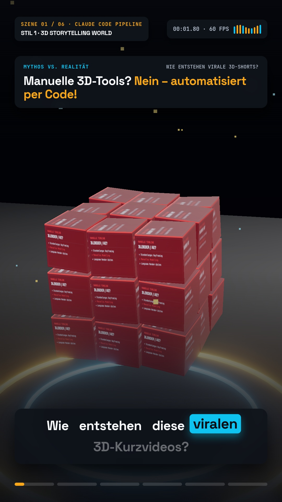
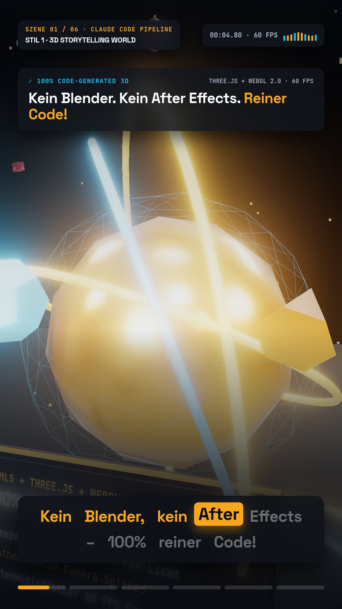
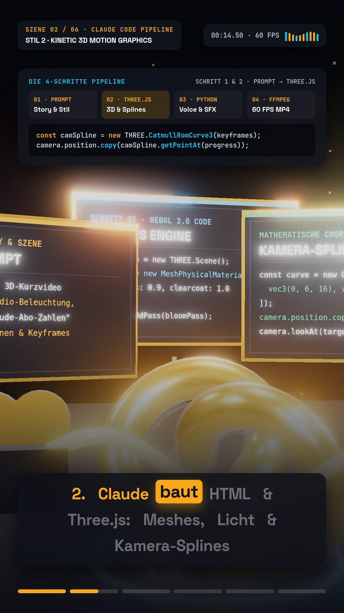
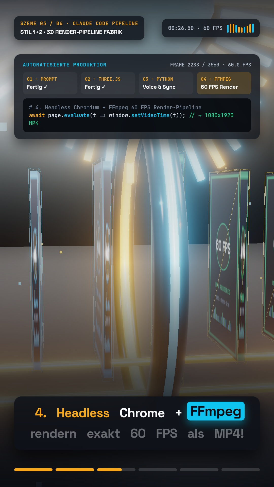
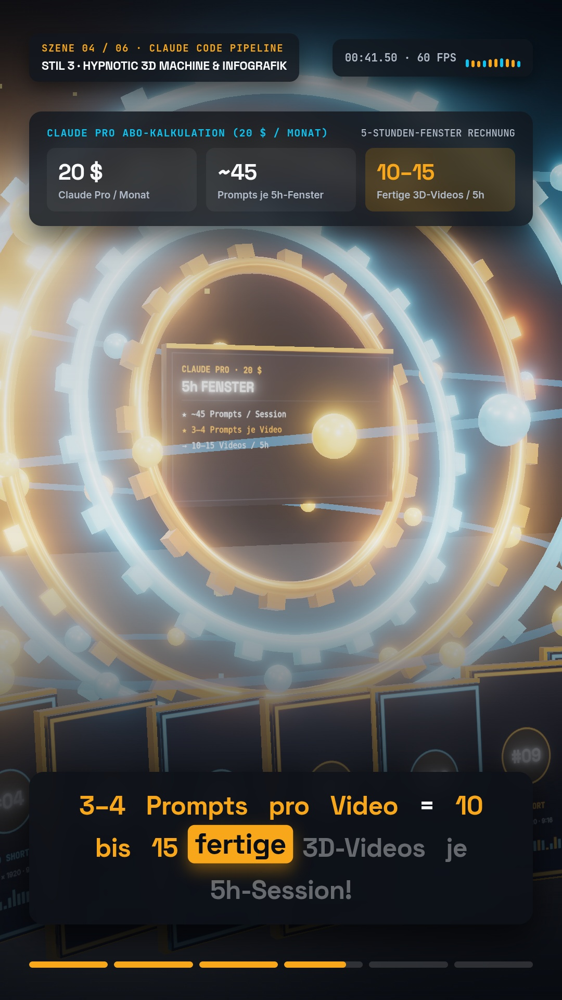
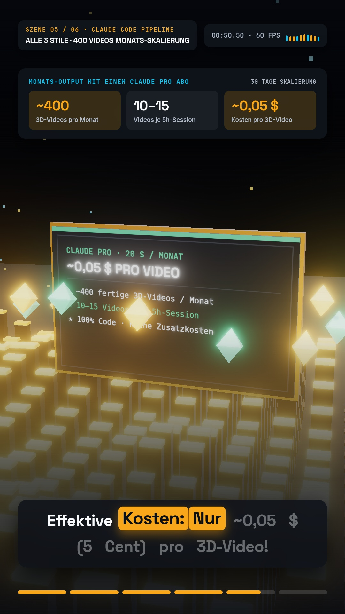

# Virales 3D-Kurzvideo per Code (HTML + Three.js + Python TTS + FFmpeg)

Dieses Repository enthält das fertig gerenderte **9:16 3D-Kurzvideo (`1080 × 1920` @ `60 FPS`, `59,40 Sek.`)** sowie die komplette Code-Pipeline (HTML5, Three.js WebGL 2.0, Python Neural TTS & Sounddesign, Headless Chromium + FFmpeg Renderer).

## Fertig gerendertes Video

- **Master 60 FPS Video (`1080×1920`, `46 MB`)**: [`output/claude_3d_viral_short_1080x1920_60fps.mp4`](./output/claude_3d_viral_short_1080x1920_60fps.mp4)
- **Komprimierte Web-Version (`1080×1920`, `60 FPS`)**: [`claude_3d_viral_short.mp4`](./claude_3d_viral_short.mp4)

---

## Szenen-Vorschau (Alle 3 Stile kombiniert)

| Szene 1 (Mythos vs. Code) | Szene 1 (Three.js Core) | Szene 2 (Kinetic Motion Graphics) |
| :---: | :---: | :---: |
|  |  |  |

| Szene 3 (60 FPS Render-Fabrik) | Szene 4 (Claude Pro 5h-Maschine) | Szene 5 (400 Videos / ~0,05 $) |
| :---: | :---: | :---: |
|  |  |  |

---

## Die Claude Pro Abo-Kalkulation (20 $ / Monat)

| Kennzahl | Wert im normalen Claude Pro Abo | Erklärung |
| :--- | :--- | :--- |
| **Monatspreis** | **20 $ / Monat** | Standard Claude Pro Abonnement |
| **Nutzungsfenster** | **~45 Prompts pro 5-Stunden-Fenster** | Erneuert sich alle 5 Stunden |
| **Prompts pro 3D-Video** | **3 bis 4 Prompts** | 1. Grundszene & Story, 2. Kamera-Splines & Licht, 3. Captions & Audio-Timing |
| **Output pro 5h-Session** | **10 bis 15 fertige 3D-Videos** | ~45 ÷ 3–4 Prompts |
| **Output pro Monat** | **~400 fertige 3D-Kurzvideos** | Selbst bei nur ~1 Session pro Tag (~30 × 13–14 Videos) |
| **Effektive Kosten pro Video** | **~0,05 $ (5 Cent)** | 20 $ ÷ 400 Videos = 0,05 $ |

---

## Projektstruktur & Reproduktion

- `index.html` / `index.css`: 9:16 Video-Stage (`1080×1920`), HUD-Telemetrie, animierte Wort-für-Wort-Captions und interaktives Studio.
- `scene3d.js`: Three.js WebGL 2.0 3D-Welt (6 Szenen, PBR-Materialien, Kamera-Splines, deterministische `window.setVideoTime(t)` API).
- `build_audio.py`: Generiert deutsches Voiceover (Piper Neural TTS), prozeduralen 125-BPM-Soundtrack, Sound-Effekte und `assets/timeline.json`.
- `render_video.js`: Paralleler Headless-Chromium + FFmpeg 60-FPS-Renderer.

### Lokales Starten & Rendern

```bash
npm install
node render_video.js
```
